# Endpoint Incident with Microsoft Defender: Detection, Investigation & Isolation

**Lab:** Microsoft 365 Business Premium tenant · Microsoft Defender for Business · Windows 11 Enterprise VM (Entra ID-joined)<br>
**Role played:** SOC / in-house security analyst<br>
**Skills:** EDR onboarding, alert and incident triage, Windows Security event logs, MITRE ATT&CK mapping, device isolation, reviewing AI output<br>
**MITRE ATT&CK:** T1136.001 Create Account: Local Account · T1098 Account Manipulation

> **TL;DR:** I onboarded a Windows 11 VM to Microsoft Defender, triggered a test detection and
> the EICAR test file, and quietly created a new local admin account. Defender caught the first
> two and built an incident from them. **It never flagged the admin account**, which I only found
> in the Windows Security log (Event IDs **4720** and **4732**). I then isolated the device from the
> portal, confirmed it was cut off, and released it six minutes later.
> An AI assistant's triage of the same incident was correct but incomplete, for the same reason:
> it only saw what the alert showed.

---

## 1. Why I built this
My [first lab](https://github.com/d4rk-source/m365-identity-incident-response) covered identity:
password attacks and Conditional Access. This one covers the endpoint. I wanted the full loop an
analyst actually works through: get a device reporting to the EDR, make something happen on it,
find it, decide what it means, and contain the machine.

## 2. Environment
- Windows 11 Enterprise (evaluation) VM in VirtualBox, joined to Entra ID as user `jonas`
- Onboarded to Microsoft Defender for Business with the local onboarding script
- Device: `desktop-4aslu44`, internal IP 10.0.2.15 (VirtualBox NAT), exposure level "Informational"

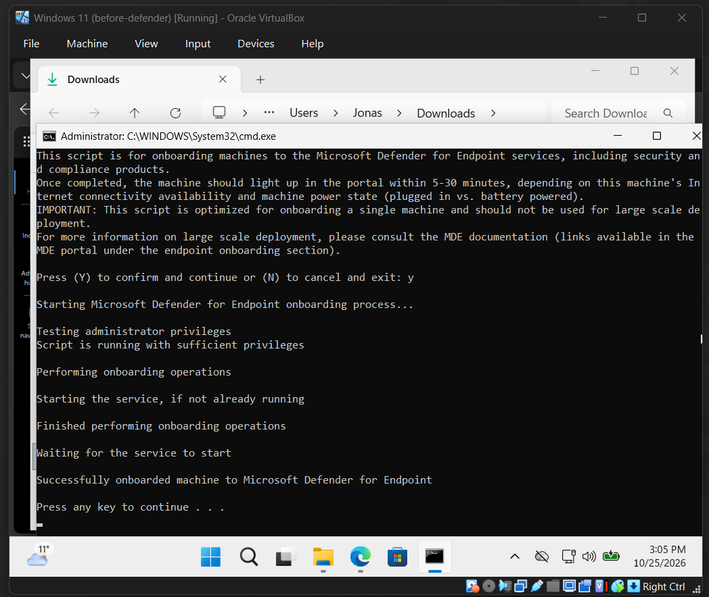
*Running the local onboarding script as administrator on the VM.*

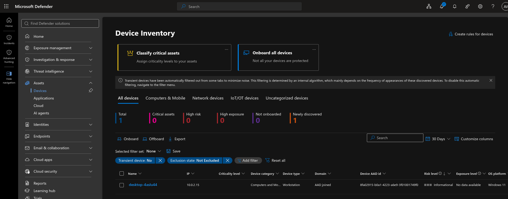
*A few minutes later the VM appears in Defender's device inventory as an AAD-joined workstation.*

## 3. Timeline (25 Oct 2026)
All times are in the Defender portal's time zone. The VM's clock was one hour off from the
portal (see [section 6](#6-investigation)), so its screenshots show 15:xx where this table says 16:xx.

| Time | Where | What happened |
|---|---|---|
| 16:05 | VM | Onboarding script completes |
| 16:08 | Defender | Alert: *[Test Alert] Suspicious PowerShell commandline* (detection test) |
| 16:10 | Defender | Incident 1 created |
| 16:22 | Defender | Alert: *'EICAR_Test_File' malware was prevented* |
| 16:30:25 | VM | Event **4720**: local account `svc_backup` created |
| 16:30:25 | VM | Event **4732**: `svc_backup` added to a security-enabled local group |
| 16:30:42 | VM | Event **4732**: `svc_backup` added to Administrators |
| 16:43 | Defender | **Isolate device** submitted; VM shows "Network Disabled" |
| 16:49 | Defender | Isolation released, connectivity restored |

## 4. What I did on the endpoint
All activity was safe and done on my own lab machine.

| # | Action | Why |
|---|---|---|
| 1 | Ran Microsoft's built-in **detection test** from the onboarding page | Proves the sensor reports to the cloud |
| 2 | Downloaded the **EICAR test file** (an industry-standard harmless file every antivirus flags) | Proves prevention works |
| 3 | Created a local account `svc_backup` and made it an **administrator** | Simulates attacker persistence: MITRE **T1136.001** (Create Account: Local Account) + **T1098** (Account Manipulation) |

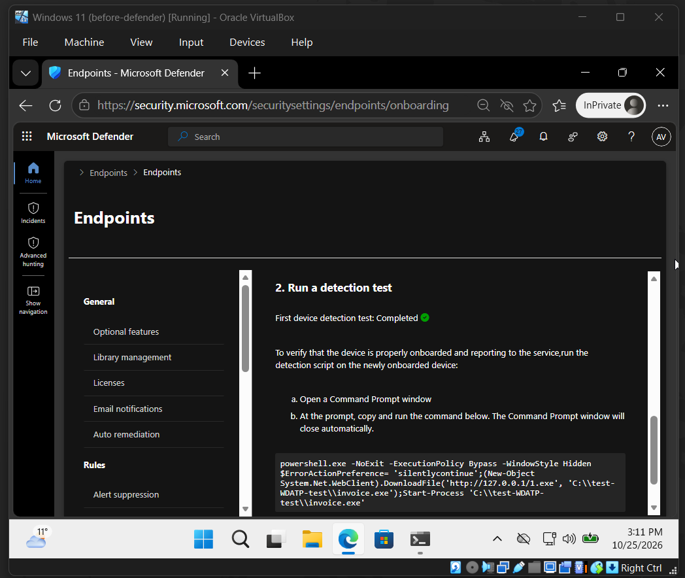
*The onboarding page confirms the first detection test completed.*

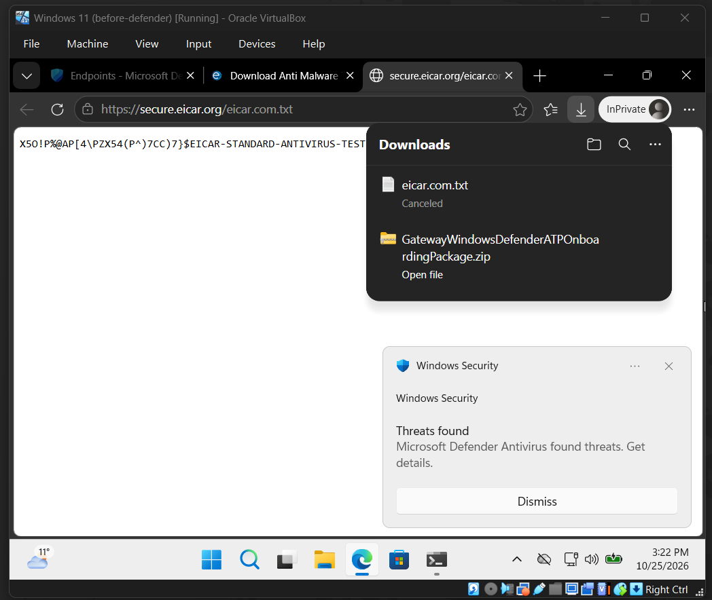
*Defender Antivirus blocks the EICAR download the moment it lands.*

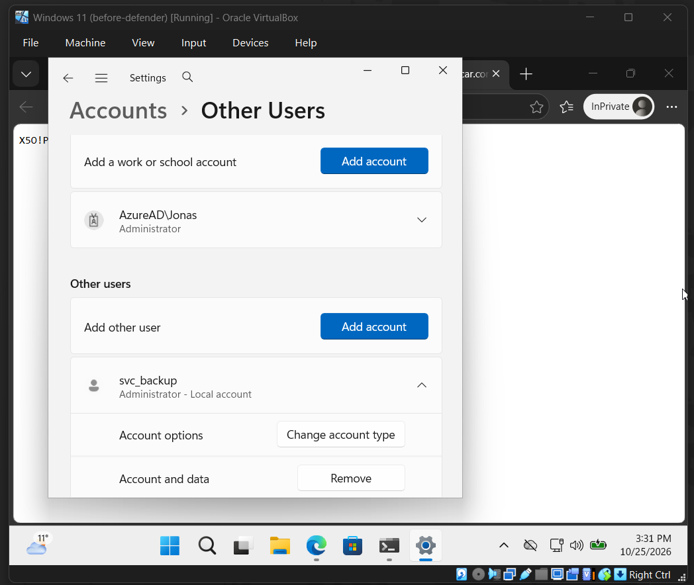
*The "attacker's" new local account, `svc_backup`, now an administrator.*

## 5. Detection
Defender grouped the activity into **one incident**:
**ID 1 – "'EICAR_Test_File' detected on one endpoint"**, severity *Informational*, tagged
*Security Testing*, categories *Execution* and *Malware*, 2 alerts:

| Time | Alert | Result |
|---|---|---|
| 16:08 | [Test Alert] Suspicious PowerShell commandline | Detected |
| 16:22 | 'EICAR_Test_File' malware was prevented | Prevented |

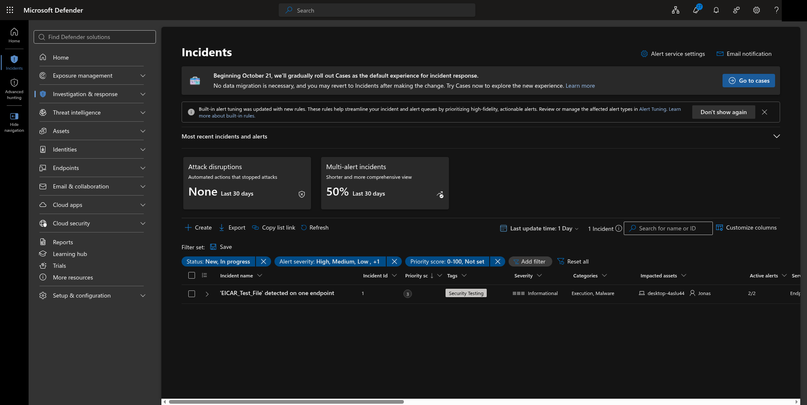
*The incident queue. Note the default severity filter: "High, Medium, Low, +1".*

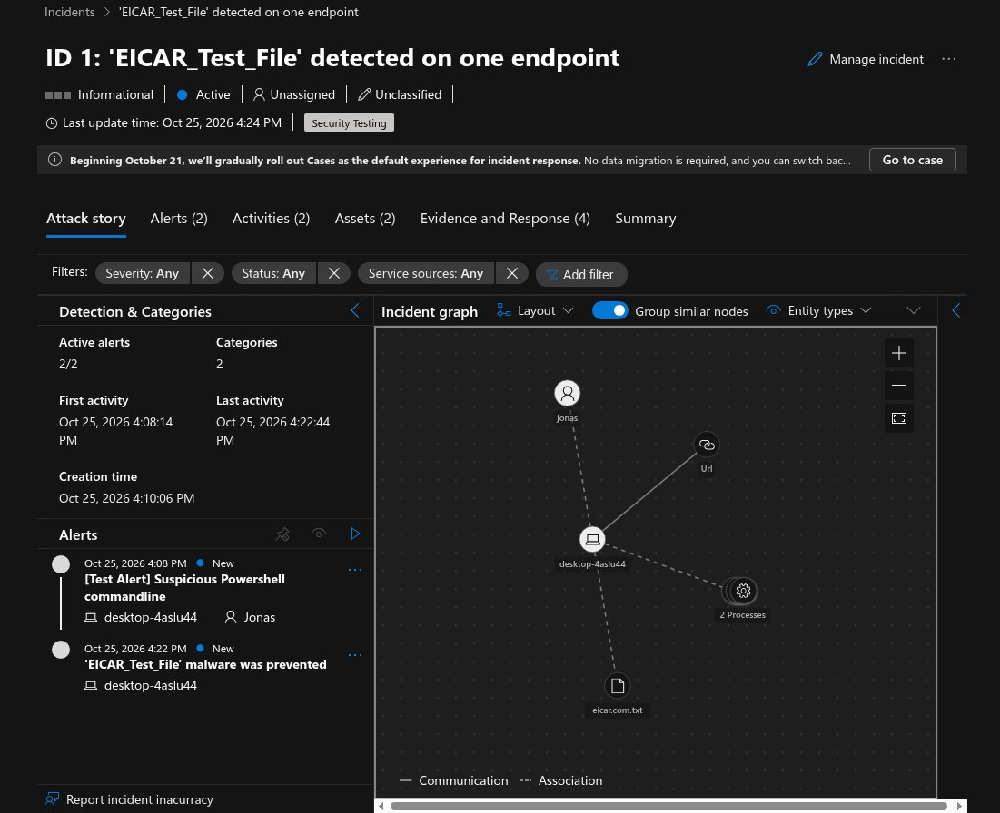
*The incident's attack story: two alerts, and a graph linking the user, device, URL, file and processes.*

**First lesson:** the incident didn't show up at first. The default Incidents view filters to
High/Medium/Low severity, and test detections are rated *Informational*. In a real SOC this is
why filter settings and alert tuning matter: low-severity signals can be hidden by default.

## 6. Investigation
The incident graph links user `jonas`, device `desktop-4aslu44`, the download URL, the file
`eicar.com.txt` and two processes. I confirmed the activity matched what I'd done.

**The part that matters most:** the admin account I created **never appeared in the incident**.
No alert fired for it. I found it in the Windows Security log:

| Time | Event ID | Meaning |
|---|---|---|
| 16:30:25 | **4720** | A user account was created (`svc_backup`) |
| 16:30:25 | **4732** | A member was added to a security-enabled local group |
| 16:30:42 | **4732** | Added to a second group (Administrators) |

All three were performed by `AzureAD\Jonas`.

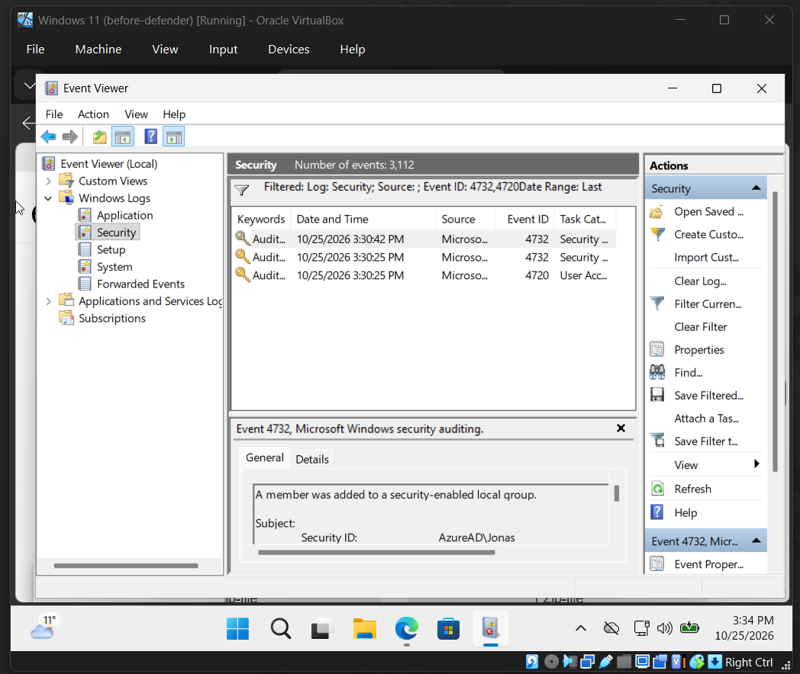
*Security log filtered on 4720 and 4732: the account creation and both group changes, all by `AzureAD\Jonas`.*

**Takeaway:** "no alert" doesn't mean "nothing happened". Quiet persistence like a new admin
account is exactly what you find by checking the event logs around an incident, not by waiting
for alerts.

**Small real-world detail:** the clocks went back an hour for the end of daylight saving time
the night before the lab, and the VM and the portal ended up an hour apart. I lined everything
up to the portal's time zone. Mixed time zones, and DST changes in particular, are a classic
source of mistakes in incident timelines.

## 7. Response: containment
1. **16:43:** submitted **Isolate device** from the Defender portal
2. The action sat at *pending* briefly until the device checked in and applied it
3. On the VM: Windows Security notified *"Network Disabled… Your administrator has caused
   Microsoft Defender to disconnect your device"*, and websites stopped loading. The device could
   still talk to Defender, but nothing else.
4. **16:49:** released the device from isolation and confirmed the internet was back
   (6 minutes isolated)
5. Cleanup: removed `svc_backup`, deleted the test file, took a clean VM snapshot

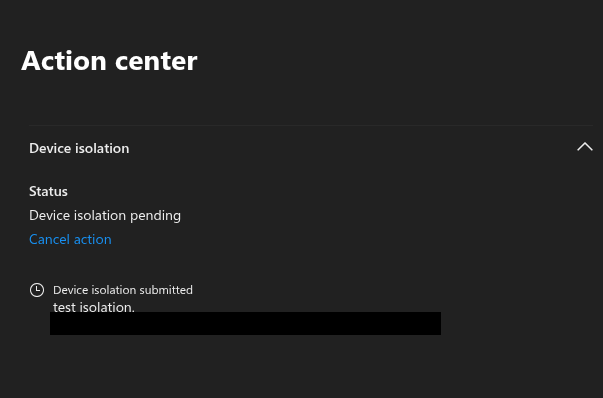
*Action center: isolation submitted and pending until the device checks in.*

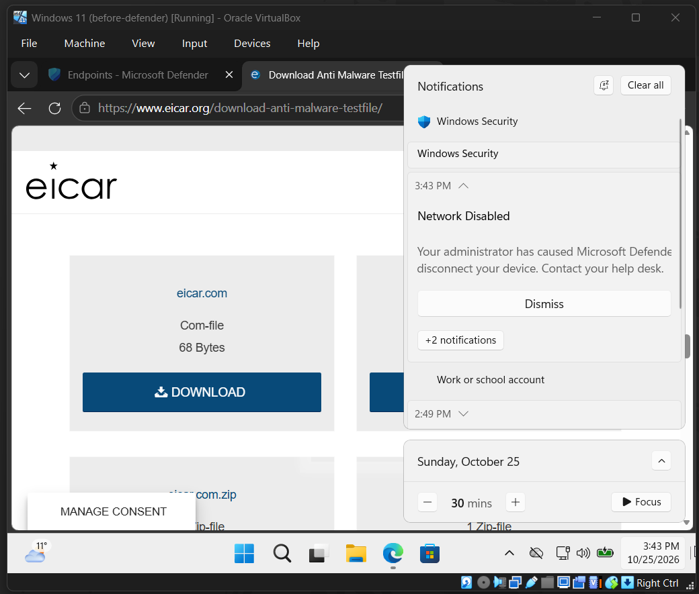
*What the user sees: Windows Security reports the device was disconnected by the administrator.*

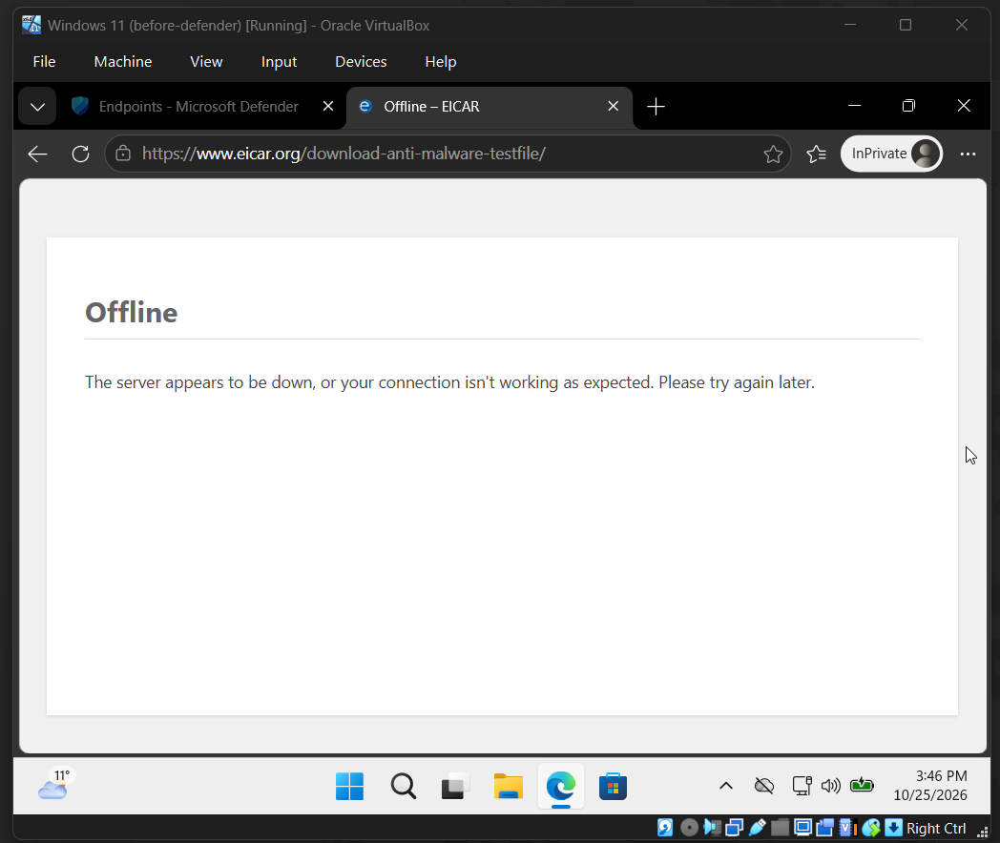
*While isolated, ordinary websites no longer load.*

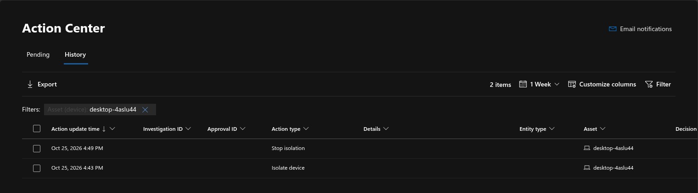
*Action center history: isolated at 16:43, released at 16:49.*

## 8. How I used AI
I gave an AI assistant a screenshot of the incident and asked: *is this a false positive, should
it worry me, and what should I do?*

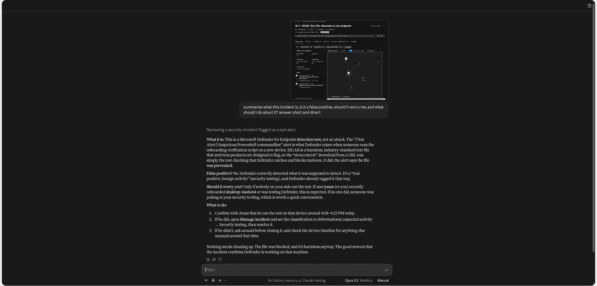
*The AI's triage of the incident, based only on the screenshot it was given.*

**What it got right:** it recognised both alerts as Defender's onboarding test and the EICAR
test file, called it a true positive / benign security testing (not a false positive), and
suggested confirming with the user and classifying the incident as security testing. That's
sensible, quick triage.

**What it got wrong:** it said *"nothing needs cleaning up"*, but there was an
unauthorised-looking admin account on the machine. It couldn't know, because that account was
never part of the incident it was shown.

**Lesson:** AI is useful for a fast first read, but it only reasons about what you give it. The
analyst still has to check what's outside the alert.

## 9. What I'd do in a real company
- Create a custom detection or alert for new local admin accounts (Event 4720 + 4732 to
  Administrators). A sketch of the hunting query I'd start from (not run in this lab, and it
  needs a licence with advanced hunting):
  ```kql
  DeviceEvents
  | where ActionType in ("UserAccountCreated", "UserAccountAddedToLocalGroup")
  | project Timestamp, DeviceName, ActionType, AccountName, AdditionalFields,
            InitiatingProcessAccountName
  | order by Timestamp desc
  ```
- Use LAPS and remove standing local admin rights, so new admin accounts stand out
- Review alert-queue filters so Informational alerts aren't silently hidden
- Write a short isolation runbook: who can isolate, how to tell the user, how to release

## 10. What I learned
- **An EDR alert tells you what it caught, and the logs tell you what it missed.**
- **Severity filters can hide real signals,** so know your default views.
- **Containment is quick to trigger.** Planning the communication and the release is the harder part.

---

*Built and written up by **Adomas Venslovas** (Alex Cipher) · [alexcipher.xyz](https://alexcipher.xyz) · [LinkedIn](https://www.linkedin.com/in/alex-cipher/)*
